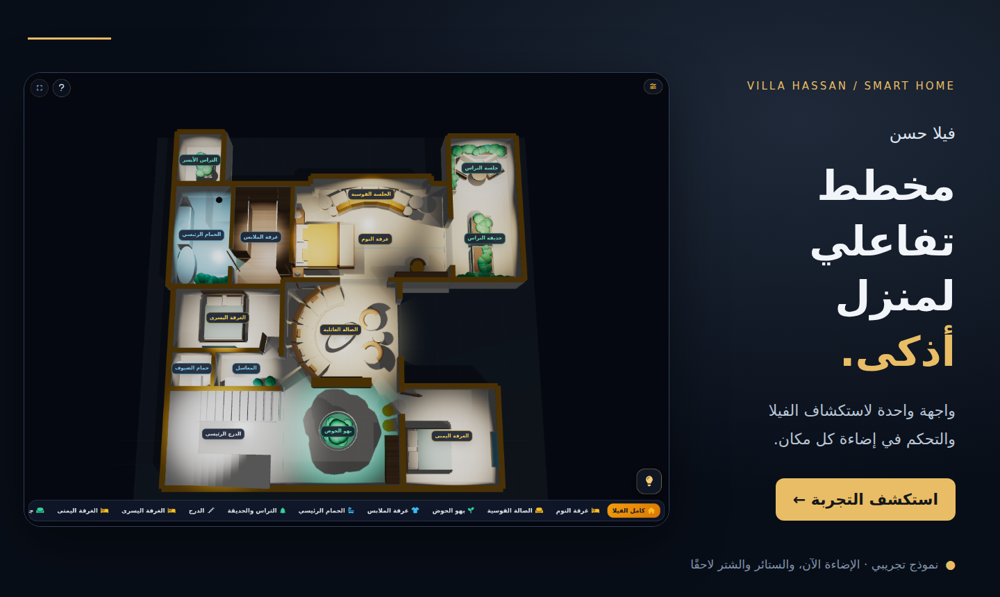
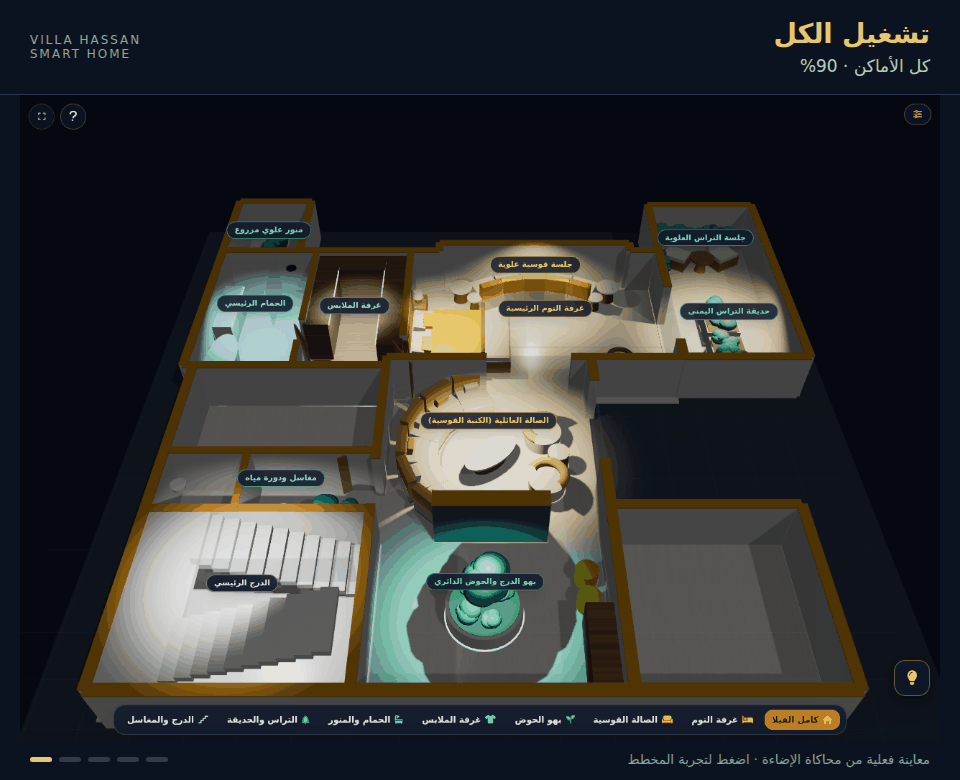
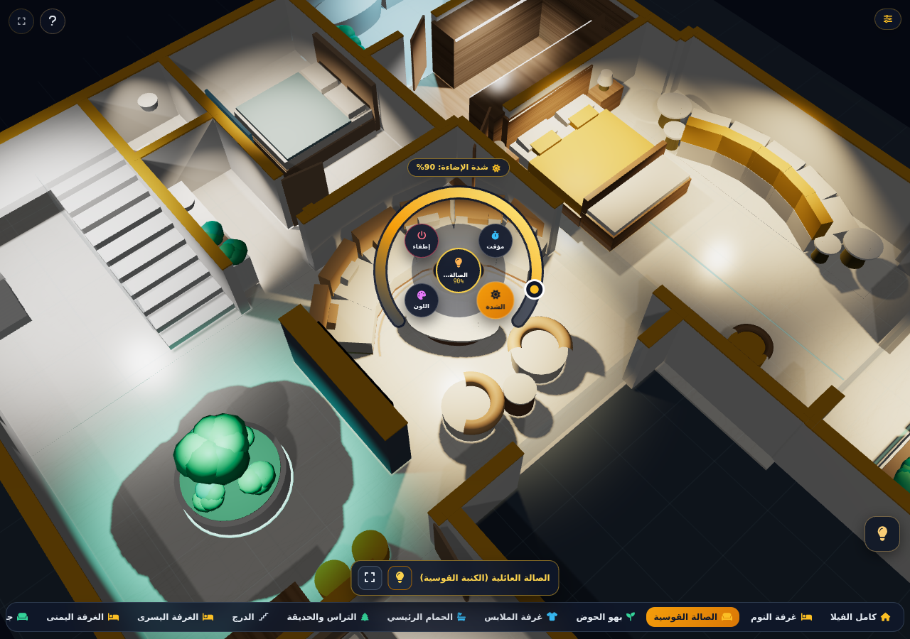
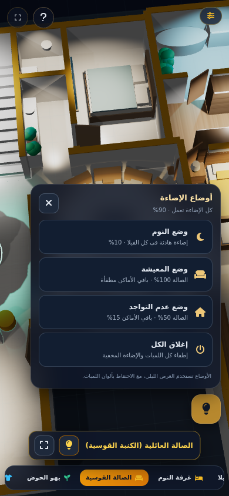
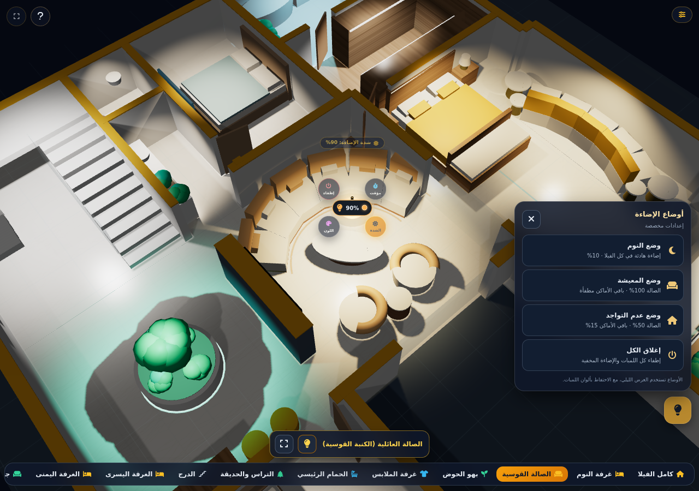
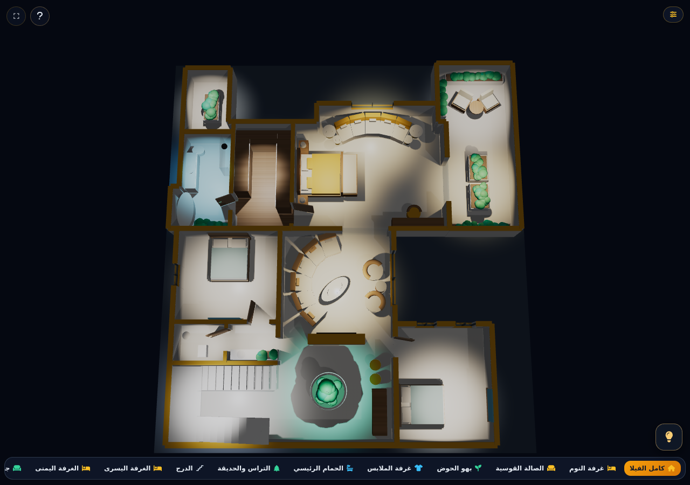

<b>VILLA HASSAN · SMART HOME</b>

<h1>فيلا حسن — المخطط التفاعلي للمنزل الذكي</h1>

شاهد المكان. اختر الغرفة. تحكّم في الإضاءة.

  <a href="https://3egy.github.io/Villa_Hassan_3D/"><b>◉ افتح شاشة التحكم التجريبية</b></a>
  &nbsp; · &nbsp;
  <a href="#preview">شاهد المعاينة</a>
  &nbsp; · &nbsp;
  <a href="#roadmap">مراحل التطوير</a>

مخطط ثلاثي الأبعاد · واجهة عربية · تفاعل باللمس · أوضاع إضاءة

## المنزل كما تراه… والتحكم من مكانه

**فيلا حسن** واجهة تجريبية للتحكم في المنزل الذكي من خلال مخطط ثلاثي الأبعاد. تختار الغرفة من المخطط نفسه، فتظهر أدوات التحكم بالأجهزة الموجودة فيها، مع معاينة مرئية لتأثير الإضاءة داخل المكان.

المشروع مُعدّ ليكون واجهة شاشة تفاعلية داخل الفيلا، ويستهدف لاحقًا التحكم عن بُعد بعد ربطه بنظام المنزل الذكي. تبدأ التجربة الحالية بالإضاءة، ثم تتوسع إلى الستائر والشتر وباقي عناصر المنزل.

> **المرحلة الحالية: نموذج تجريبي تفاعلي.** أوامر الإضاءة تعمل داخل محاكاة المتصفح. الربط بالأجهزة الفعلية والتحكم عن بُعد جزء من مرحلة التكامل القادمة.

## شاهد التجربة

اضغط على المعاينة لفتح المخطط وتجربة التحكم بنفسك.

*المعاينة مأخوذة من الشاشة الحالية: تشغيل الكل، النوم، المعيشة، عدم التواجد، ثم إغلاق الكل.*

## من المخطط إلى اللمبة

| الخطوة | ما الذي يحدث؟ |
| --- | --- |
| **١ · استكشف الفيلا** | شاهد المخطط كاملًا وحرّك الكاميرا وقرّب الأماكن المطلوبة. |
| **٢ · اختر المكان** | المس المخطط لإظهار الأسماء، ثم اضغط اسم الغرفة أو اخترها من الشريط السفلي. |
| **٣ · تحكّم بالإضاءة** | تظهر لمبات المكان مع نسبة الشدة وعينة اللون؛ اضغط اللمبة لتفتح أدوات التحكم. |
| **٤ · اختر وضعًا سريعًا** | استخدم زر اللمبة أسفل اليمين؛ يعود العرض تلقائيًا للفيلا كاملة لرؤية تأثير الوضع. |

<table>
  <tr>
    <td width="64%" align="center">
      <b>تحكم مباشر داخل الغرفة</b>  
      
      
الشدة واللون والمؤقت في متناول اللمس.

    </td>
    <td width="36%" align="center">
      <b>واجهة تتكيف مع الهاتف</b>  
      
      
نفس المخطط وأوضاع التحكم على شاشة أصغر.

    </td>
  </tr>
</table>

## إضاءة تناسب اللحظة

| الوضع | إضاءة الصالة | باقي الأماكن | الاستخدام |
| --- | --- | --- | --- |
| 🌙 **النوم** | 10% | 10% | إضاءة خافتة وهادئة في الفيلا. |
| 🛋️ **المعيشة** | 100% | مطفأة | تركيز الإضاءة في الصالة. |
| 🏠 **عدم التواجد** | 50% | 15% | تخفيف الإضاءة العامة وإبقاء الصالة على شدة متوسطة. |
| ⏻ **إغلاق الكل** | مطفأة | مطفأة | إطفاء اللمبات والإضاءة المخفية. |
| 💡 **تشغيل الكل** | 90% | 90% | يظهر بدل «إغلاق الكل» عندما تكون جميع اللمبات مطفأة. |

يمكن تخصيص أي لمبة بعد تطبيق الوضع. تحتفظ الأوضاع بألوان اللمبات المختارة وتعرض تأثيرها في المشهد الليلي.

<b>افتح صورة قائمة الأوضاع</b>

## المتاح في التجربة الحالية

<b>💡 تحكم بالإضاءة داخل كل مكان</b>

- تشغيل وإطفاء اللمبات، وضبط الشدة واللون.
- سحب متواصل لأقواس الشدة واللون والمؤقت على شاشات اللمس، مع إصلاح إلغاء السحب في أندرويد.
- مؤقت لإطفاء اللمبة تلقائيًا داخل الجلسة.
- نسبة الشدة وعينة اللون بجوار أيقونة اللمبة.
- إضاءة محلية وظلال توضح أثر التغيير على المكان.
- الإضاءة المخفية تتبع إعدادات إضاءة الغرفة.

<b>🏡 مخطط واضح وتجربة لمس سلسة</b>

- عرض أقرب للفيلا كاملة من أعلى، من دون أيقونات لمبات تزاحم المخطط.
- أسماء أماكن صغيرة تظهر عند لمس المخطط، وتختفي تلقائيًا بعد ٣٫٥ ثوانٍ.
- إظهار لمبات المكان المختار فقط، مع تقريب الكاميرا إلى حدود الغرفة.
- تأطير يناسب الهاتف بالطول والعرض، بما في ذلك جناح النوم الرئيسي.
- اختيار وضع إضاءة يعيد الكاميرا للفيلا كاملة ويخفي لمبات الغرف وأسماء الأماكن حتى تتفاعل مع المخطط.
- اسم الغرفة المختارة ثابت فوق شريط التنقل السفلي.
- المقاسات مخفية افتراضيًا ويمكن إظهارها عند الحاجة.
- التبديل بين العرض الليلي والنهاري، مع أدوات لعرض الطبقات.
- واجهة عربية تدعم أحجام الكمبيوتر والهاتف.

## من شاشة تجريبية إلى تحكم متكامل

| المرحلة | النطاق | الحالة |
| --- | --- | --- |
| **١ · المخطط والإضاءة** | تنقل بين الغرف، تحكم فردي باللمبات، وأوضاع إضاءة عامة | متاح كتجربة تفاعلية |
| **٢ · الستائر والشتر** | إضافة أدوات الفتح والإغلاق ونسبة الفتح داخل الغرفة | مخطط للتطوير |
| **٣ · الربط بالأجهزة** | إرسال الأوامر للأجهزة الفعلية واستقبال حالتها وتأكيد تنفيذها | مرحلة تكامل قادمة |
| **٤ · الشاشة داخل الفيلا والتحكم عن بُعد** | تجهيز واجهة التشغيل للشاشة الفعلية، وتنظيم الوصول المحلي والبعيد | مستهدف لاحقًا |
| **٥ · باقي عناصر المنزل** | إضافة وحدات التحكم الأخرى وفق الأجهزة والاحتياج الفعلي | توسع لاحق |

اختيار نظام الربط وبروتوكولات الأجهزة يتم في مرحلة التكامل وفق تجهيزات الفيلا.

<b>معلومات التشغيل والتطوير</b>

- العرض الحالي مبني باستخدام **HTML وCSS وJavaScript وThree.js / WebGL**.
- ملف `index.html` يضم المشهد وأدوات التحكم ومكتبات التشغيل، ويعمل من دون خطوة بناء.
- يمكن فتحه محليًا مع ملفات الحزمة أو تشغيل النسخة المنشورة على GitHub Pages.
- إعدادات الإضاءة الحالية خاصة بجلسة المتصفح وتعود للقيم الافتراضية عند إعادة تحميل الصفحة.
- لا تتضمن النسخة الحالية خدمة خلفية أو اتصالًا بأجهزة المنزل.

[دليل التشغيل والنشر](docs/DEPLOYMENT.md) · [إشعارات المكتبات](THIRD_PARTY_NOTICES.md)

---

<b>التحكم يبدأ من المكان الذي تعرفه.</b>

<a href="https://3egy.github.io/Villa_Hassan_3D/"><b>جرّب مخطط فيلا حسن الآن ←</b></a>

