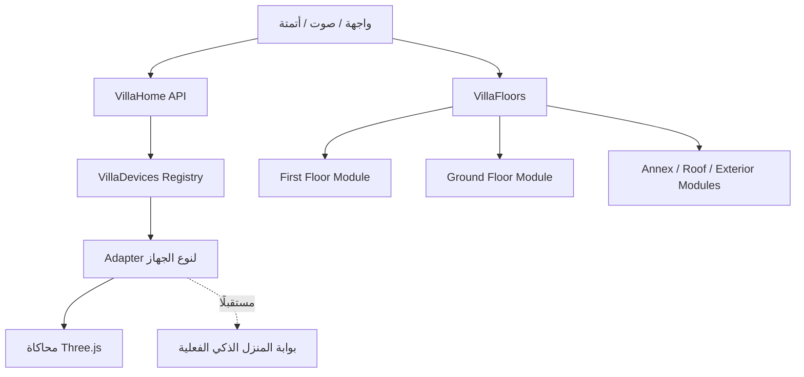

# تصميم النظام متعدد الأدوار | v4.0

## مبادئ النظام

1. **كل دور مستقل في المسقط والمشهد والبيانات**، ولا توجد إعادة تسجيل لأجهزة الدور الأول عند تبديل الدور.
2. **السجل موحد** `VillaDevices`، ومعرف الجهاز دائمًا عالمي وفريد. كل جهاز يحمل `floorId` و`zoneId`، والـRegistry يتحقق أن الغرفة تنتمي إلى الدور.
3. **الدور النشط** `VillaFloors.activeId` يتحكم في الظهور والانتقال بالكاميرا وإظهار أسماء الغرف ونقاط الأجهزة.
4. **المجموعات الافتراضية** في `VillaHome.executeGroup` تستهدف الدور النشط، ولا تستهدف كل الأدوار إلا عند تمرير `allFloors:true` بوضوح.
5. **كل نظام جديد** يحتاج Adapter لنوع الجهاز يعرّف إمكانياته ونقل الحالة، ولا يحتاج تعديل كود الكاميرا أو الجدران.
6. **الواجهة/الصوت/الأوضاع** تبقى خدمات عامة؛ التخصيص بالموقع يتم عبر `floorId` و`roomId` و`deviceId`.

## دورة العمل



## إضافة دور جديد

- أنشئ `js/floors/<id>/data.js` يصف الغرف وأبعاد الدور والمرجع.
- أنشئ `js/floors/<id>/scene.js` فيه دوال `build()`, `setWallHeight()` وما يلزم للطبقات.
- سجّل Floor Manifest: `id,label,rooms,roomBounds,overviewBounds,getSceneGroup` عبر `VillaFloors.register()`.
- اعط لكل غرفة ID غير متكرر بين أدوار الفيلا (مثال `annexOffice`).
- أضف عناصر الدور الجديدة إلى واجهة `VillaFloorSwitcher` تلقائيًا من السجل؛ لا تحتاج نسخ الشريط السفلي يدويًا.
- الفتحات المؤكدة توضع في ملف بيانات مستقل؛ لا تستخدم معرفات W3 في أكثر من دور دون namespace.

## إضافة نوع جهاز (مثال: Speaker)

```js
VillaDevices.registerAdapter('speaker', {
  async execute(device, action, value, context) {
    // تنفيذ محاكاة أو إرسال أمر إلى بوابة مخصصة لاحقًا.
    // لا تعدّل الحالة إلا بعد التأكد من تنفيذ الأمر:
    context.reportState({ volume: value });
  }
});
VillaDevices.register({
  id: 'ground_speaker_living_1',
  floorId: 'ground', zoneId: 'groundFamilyLiving',
  kind: 'speaker', name: 'سماعة صالة الدور الأرضي',
  capabilities: ['setVolume'], initialState: { volume: 20 }
});
```

هذا **مثال فقط**؛ لا توجد سماعة مضافة بالفعل في v4.0.

## تنسيق الحركة الخارجية مستقبلًا

حاليًا يظهر دور واحد عند كل مرة، وكل مسقط داخل إحداثياته المحلية. لعمل مشهد خارجي مكدّس:

- تثبيت نقطة أصل مشتركة للفيلا من مراجع معتمدة (مثل بئر السلم أو محاور المبنى).
- تثبيت ارتفاعات البلاطات الحقيقية واتجاه كل دور.
- بناء `buildingTransform` لكل دور ثم تحويل المشاهد/الإضاءات والانتقال بينها بطريقة سلسة.
- المحافظة على منفصلة `floor-local` / `building-space` للمحاكاة والتخزين؛ لا يتم افتراض ارتفاع 3 أمتار أو محاذاة غير موثقة الآن.

## الحالة التقنية

النسخة الحالية Static Site بدون Build وبنفس مكتبة Three.js الموجودة. بدأنا بفصل ملفات الدور الأول الفعلية إلى `js/floors/first/`، مع بقاء خدمات العرض والأنظمة المشتركة في `js/core`, `js/devices`, `js/scene`, `js/voice`, `js/ui`. الهدف عدم تعطيل التطبيقات القائمة مع التوسع التدريجي.
